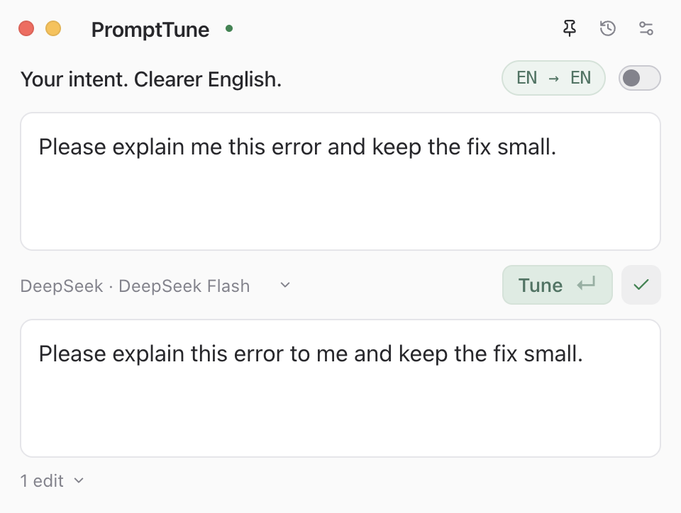
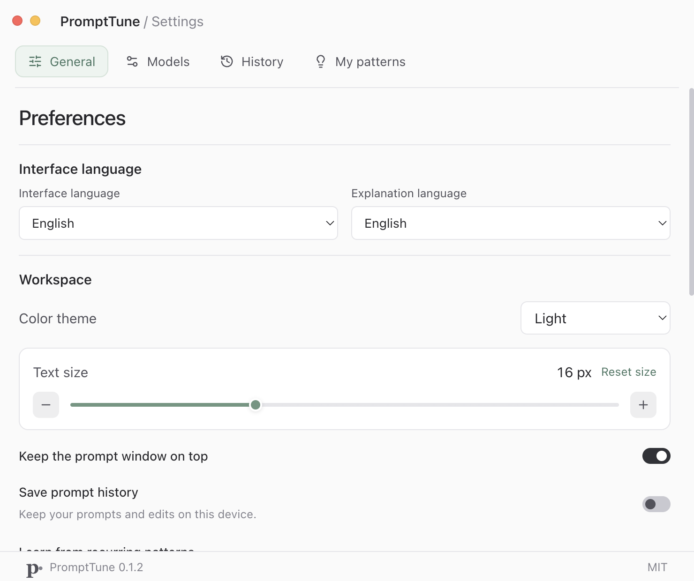
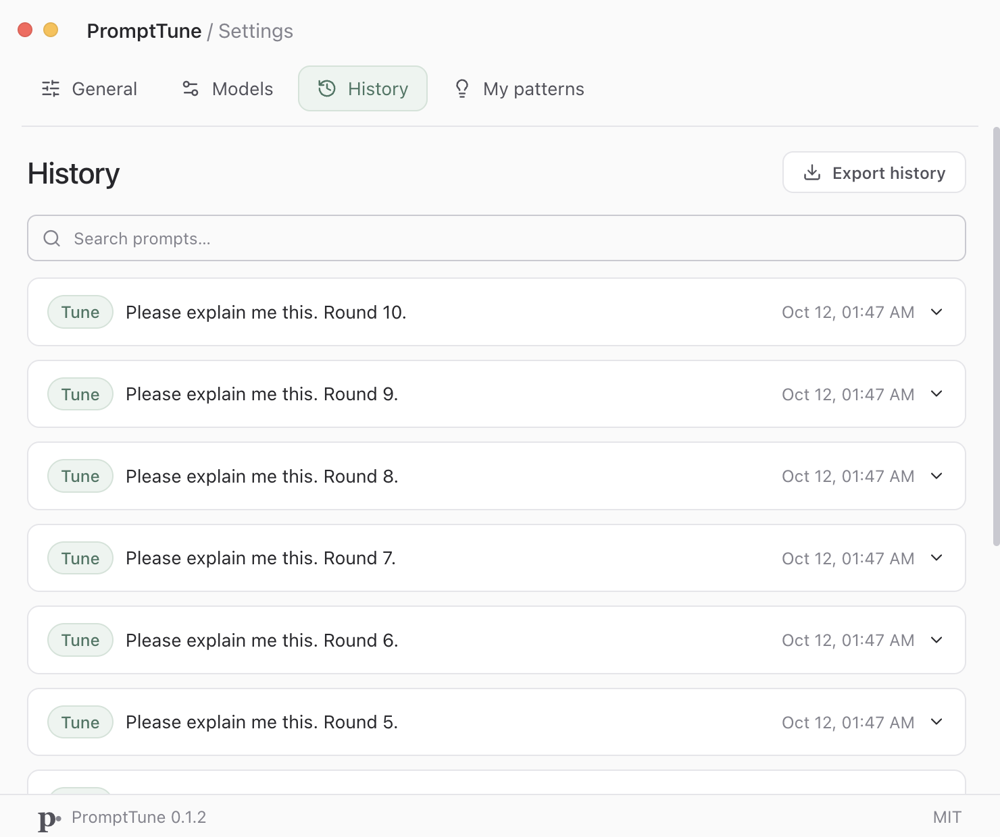

# PromptTune

保留原意，调准英文 Prompt。一个可置顶、可缩放的桌面悬浮工具。

Translate Chinese prompts, lightly tune English prompts, and learn from recurring expression patterns.



默认 480px 宽的五行悬浮面板，输入和输出均从三行开始，随内容平滑增高。文字默认 16px，可在设置中调整为 12–24px，立即作用于所有窗口并记住选择。支持跟随系统、Light、Black 三种配色；Tune 使用浅绿、Translate 使用雾蓝。


实录：使用已配置的 DeepSeek API 完成英文 Tune 与中文翻译，展示输入、等待、流式输出、模式切换和复制反馈。录制样例未写入个人历史。

## 使用 / Getting started

从 [Releases](https://github.com/winbeau/prompt-tune/releases/latest) 下载 macOS Apple Silicon 安装包，将 PromptTune 拖入 Applications 并打开。

1. 按 `⌘,` 打开设置 → **模型管理 / Models**。
2. 在 DeepSeek 中填入 API key，点击**保存 / Save changes**。应用自动获取模型；翻译、微调、总结已有默认绑定。
3. 回到悬浮窗选择 **Translate · CN → EN** 或 **Tune · EN → EN**，粘贴内容，按 `Return`。
4. 点击复制，只复制最终英文 Prompt。

v0.1.2 macOS 包未进行 Developer ID 签名或公证。首次从网上下载安装，若被系统拦截，可在系统设置 → 隐私与安全性中选择“仍要打开”。安装包要求 macOS 13 或更新版本；本次实机验证环境为 macOS 27 / Apple Silicon。Windows 实机交互尚未验证。

## 功能 / Features

| 功能                    | 行为                                                                                                                   |
| ----------------------- | ---------------------------------------------------------------------------------------------------------------------- |
| **Translate · CN → EN** | 忠实翻译中文需求，保留约束、技术术语和代码。                                                                           |
| **Tune · EN → EN**      | 最小必要改动，修正语法、用词和表达，保持原意和语气。                                                                   |
| **中文 / English UI**   | 可即时切换或跟随系统；解释语言可单独选择。两种模式始终输出英文。                                                       |
| **模型管理**            | 自研轻量模型层。DeepSeek、OpenCode Zen/Go、自定义第三方 API；支持 Chat Completions、Responses、Messages 三种文本协议。 |
| **配置与凭据**          | 模型发现、缓存、手动模型、协议覆盖、收藏、启用、独立任务绑定、连接检查、配置导入导出；API key 加密保存。               |
| **本地历史**            | 检索、查看、逐条删除、清空、JSON 导出；可在设置中关闭历史。                                                            |
| **表达习惯**            | 默认每 10 个成功保存的独立轮次后台总结；来源记录可查看、可否认纠正、可忽略或标记已掌握。                               |
| **悬浮窗**              | 默认置顶，边缘拖拽缩放，标题栏拖动，位置记忆，托盘呼出，独立设置窗。禁用全屏与最大化。                                 |
| **字号与外观**          | 默认 16px，12–24px 可调；跨窗口同步并持久化，放大不改变面板宽度。淡雅模式胶囊、紧凑设置页与舒适的 Tab 间距。           |

Pi 只作为分层设计参考，运行时使用 PromptTune 自己的模型层。
OpenCode 的模型按官方 endpoint 目录选择协议；未知模型需要手动指定，不根据名称猜测。Gemini 原生协议和多模态模型暂不支持。
第三方服务需兼容上述文本协议，使用 HTTPS；本地服务允许 loopback HTTP。仅有 API key 不代表账号余额或具体模型权限已满足。

## 快捷键 / Shortcuts

| 操作            | macOS             | Windows                    |
| --------------- | ----------------- | -------------------------- |
| 呼出 / 隐藏     | `⌘⇧Space`，可修改 | `Ctrl+Shift+Space`，可修改 |
| 提交            | `Return`          | `Enter`                    |
| 换行            | `Shift+Return`    | `Shift+Enter`              |
| 放大字体        | `⌘+` / `⌘=`       | `Ctrl+` / `Ctrl+=`         |
| 缩小字体        | `⌘−`              | `Ctrl+−`                   |
| 恢复默认字号    | `⌘0`              | `Ctrl+0`                   |
| 设置            | `⌘,`              | `Ctrl+,`                   |
| 关闭当前窗口    | `⌘W`              | `Ctrl+W`                   |
| 退出应用        | `⌘Q`              | `Ctrl+Q`                   |
| 隐藏 / 关闭设置 | `Esc`             | `Esc`                      |

关闭悬浮窗会保留托盘进程；退出才结束应用。支持常用复制、粘贴、撤销、重做、全选。

## 历史与总结 / History & insights

Translate 和 Tune 都计入默认 10 轮触发数；失败、取消、待澄清、历史关闭和同轮重新生成不会增加独立轮次。
只有英文 Tune 中有可信原文证据的纠正才用于统计英文错误；中文译法和可选风格建议不算语法错误。出现次数从不同历史来源计算。

历史保存在本机 SQLite。处理文本发送给当前任务配置的 API；自动总结开启时，可信纠错片段也会发送给总结模型。设置可以关闭它、修改批次大小和每日调用上限。
后台优先让位给前台请求，队列重启可恢复。超大批次使用有界的完整证据片段，可能跳过超出预算的改动。
API key 通过 Electron safeStorage 加密，配置导出不含密钥；安全加密不可用时仅在当前会话保存，并在界面提示。

## 开发 / Development

需要 Node.js 24+。

```sh
npm ci
npm run dev
```

```sh
npm run format:check
npm test
npm run build
npm run test:e2e   # 实际桌面窗口 + 本地模拟 API；不使用真实密钥
npm run package:mac
```

测试覆盖协议解析、受保护片段、凭据、批次与证据，并通过实际 Electron 窗口验证两种模式、语言切换、快捷键、重启和第 10 轮总结。模拟接口验证不等于真实模型的语言质量评测。

v0.1.2 通过 27 项核心测试和 20 项 macOS 桌面检查，包括字号上下限、旧设置升级、快捷键、两窗口同步、最窄窗口布局与重启恢复。另以真实 DeepSeek 完成两条公开演示样例；这属于连接与功能实测，不代表系统性的语言质量评测。





历史页截图使用自动化测试样例；GIF 使用真实 API 返回。

- [当前实现、验证范围与限制](docs/IMPLEMENTATION.md)
- [开发计划与后续验收项](docs/DEVELOPMENT_PLAN.md)
- [模型管理设计](docs/MODEL_MANAGEMENT.md)
- [GitHub 调研](docs/RESEARCH.md)
- [第三方许可证](THIRD_PARTY_NOTICES.md)

刷新 OpenCode 官方 endpoint 目录：`node scripts/refresh-catalog.mjs`。更新依赖后重新生成声明：`node scripts/notices.mjs`。

## License

[MIT](LICENSE) · Copyright (c) 2026 winbeau
