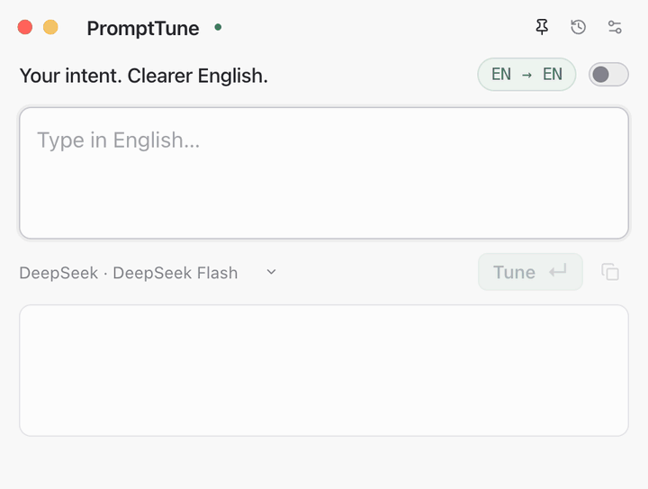

<h1 align="center">PromptTune</h1>

<p align="center">Your intent. Clearer English.</p>

<p align="center">
  <a href="https://github.com/winbeau/prompt-tune/actions/workflows/ci.yml">
    
  </a>
  <a href="https://github.com/winbeau/prompt-tune/releases/latest">
    
  </a>
  <a href="LICENSE">
    
  </a>
</p>

<p align="center">
  
</p>

## 使用

从 [Releases](https://github.com/winbeau/prompt-tune/releases/latest) 下载对应安装包：macOS 13+（Apple Silicon / Intel）或 Windows x64（预览版）。macOS 将应用拖入 Applications；Windows 运行安装程序。

1. 打开设置 → **模型管理**，选择供应商并保存 API key。
2. 回到悬浮窗，选择模式和模型。
3. 输入内容并提交，生成后点击复制按钮获取英文 Prompt。

macOS 安装包使用本地签名，尚无 Developer ID 签名或公证；若首次打开被拦截，可在系统设置 → 隐私与安全性中选择“仍要打开”。目前仅 Apple Silicon 完成桌面实测。

## 功能

| 模式                    | 用途                                                                     |
| ----------------------- | ------------------------------------------------------------------------ |
| **Translate · CN → EN** | 将中文需求译成自然英文，保留约束、技术术语和代码。                       |
| **Tune · EN → EN**      | 修正语法、用词和生硬表达，以必要的局部改写得到自然英文，保留原意与语气。 |

- **紧凑悬浮窗**：默认宽 480px，支持置顶、拖动、缩放与位置记忆。输入和输出从三行开始随内容平滑增高，结果流式显示。
- **外观与字号**：跟随系统、Light、Black 三种主题；浅绿与雾蓝区分模式。文字默认 16px，可调至 12–24px，各窗口同步并记住选择。
- **双语界面**：中文、English 或跟随系统；纠错解释的语言可单独设置。

## 模型管理

支持 **DeepSeek、OpenCode Zen/Go 和第三方 API**，兼容 Chat Completions、Responses、Messages 三种文本协议。第三方服务使用 HTTPS，本地服务允许 loopback HTTP；暂不支持 Gemini 原生协议与多模态。

提供自动模型发现与缓存、手动添加、收藏、启用和连接检查。翻译、微调、总结可分别绑定供应商与模型，配置可导入导出。模型层独立实现，Pi 仅作为设计参考。

每次翻译或微调独立发送当前原文，不携带上一轮输入、输出、历史或习惯总结。

## 历史与隐私

历史保存在本机 SQLite，支持检索、删除、清空与 JSON 导出，也可关闭保存。默认每 **10 个成功保存的独立轮次**在后台调用 API 总结表达习惯；两种模式均计入轮次，失败、取消与同轮重新生成不重复计数。

大小写、空白和句尾句号会静默修正，不计入 edits；旧历史中的此类修改及关联证据会在升级时移除，原文与输出保留。习惯统计仅采用英文 Tune 中有原文证据的纠正，排除中文译法和可选风格建议。每条习惯可查看来源、否认纠正、忽略或标记已掌握。后台任务优先让位给前台，重启后可恢复；总结开关、批次大小与每日调用上限均可调整。

输入会发送给当前任务配置的 API；开启自动总结时，纠错片段也会发送给总结模型。API key 通过 Electron safeStorage 加密，配置导出不含密钥；安全加密不可用时仅在当前会话保存，并在界面提示。

## 快捷键

| 操作            | macOS          | Windows             |
| --------------- | -------------- | ------------------- |
| 呼出 / 隐藏     | `⌘⇧Space`      | `Ctrl+Shift+Space`  |
| 提交当前模式    | `Return`       | `Enter`             |
| 换行            | `Shift+Return` | `Shift+Enter`       |
| 放大字体        | `⌘+` / `⌘=`    | `Ctrl++` / `Ctrl+=` |
| 缩小字体        | `⌘−`           | `Ctrl+−`            |
| 恢复默认字号    | `⌘0`           | `Ctrl+0`            |
| 设置            | `⌘,`           | `Ctrl+,`            |
| 关闭当前窗口    | `⌘W`           | `Ctrl+W`            |
| 退出应用        | `⌘Q`           | `Ctrl+Q`            |
| 隐藏 / 关闭设置 | `Esc`          | `Esc`               |

呼出快捷键可在设置中修改。关闭悬浮窗后应用留在托盘，退出才结束进程。

## 开发

使用 Electron、React 与 TypeScript，需要 Node.js 24+。

```sh
npm ci
npm run dev
```

```sh
npm run format:check
npm test
npm run build
npm run test:e2e
```

桌面测试使用本地模拟 API 与假密钥。打包使用 `npm run package:mac`（Apple Silicon）或 `npm run package:win`（x64）。

## 文档

- [实现与验证范围](docs/IMPLEMENTATION.md)
- [开发计划](docs/DEVELOPMENT_PLAN.md)
- [模型层设计](docs/MODEL_MANAGEMENT.md)
- [更新日志](CHANGELOG.md)
- [第三方许可证](THIRD_PARTY_NOTICES.md)
